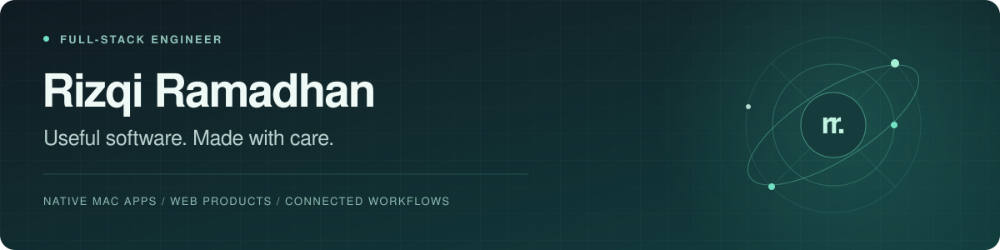

  

  <a href="https://rizqiramadhan.dev"><strong>Portfolio</strong></a> &nbsp;·&nbsp;
  <a href="https://rizqiramadhan.dev/#apps">Mac apps</a> &nbsp;·&nbsp;
  <a href="mailto:rizqiramadhan2312@gmail.com">Get in touch</a>

I’m **Rizqi**, a full-stack engineer building native Mac apps, web products, and connected workflows. I care about the details that make software feel good to use—and the systems that make it work.

### Selected work

<table>
  <tr>
    <td width="50%" valign="top">
      <h3><a href="https://notchlet.rizqiramadhan.dev">Notchlet</a></h3>
      
Music and your next calendar event, right at your Mac’s notch.

      
Swift · SwiftUI · macOS

      <a href="https://notchlet.rizqiramadhan.dev">Explore the app →</a>
    </td>
    <td width="50%" valign="top">
      <h3><a href="https://tuck.rizqiramadhan.dev">Tuck</a></h3>
      
A calmer menu bar, with hidden apps still within easy reach.

      
Swift · SwiftUI · macOS

      <a href="https://tuck.rizqiramadhan.dev">Explore the app →</a>
    </td>
  </tr>
  <tr>
    <td width="50%" valign="top">
      <h3><a href="https://rizqiramadhan.dev/work/business-operations-erp/">Business Operations Mini ERP</a></h3>
      
One workspace connecting sales, purchasing, payments, and deliveries.

      
Next.js · React · TypeScript

      <a href="https://rizqiramadhan.dev/work/business-operations-erp/">Case study</a> · <a href="https://rizqi-demo-erp.vercel.app/">Try the demo →</a>
    </td>
    <td width="50%" valign="top">
      <h3><a href="https://rizqiramadhan.dev/work/ai-document-workflows/">AI Document Workflows</a></h3>
      
Reusable skills that turn PDFs into spreadsheet updates and structured business data.

      
AI workflows · PDF extraction · Google Sheets

      <a href="https://rizqiramadhan.dev/work/ai-document-workflows/">Case study</a> · <a href="https://rizqi-demo-documents.vercel.app/">Try the demo →</a>
    </td>
  </tr>
</table>

### What I work with

**Native apps** &nbsp; Swift · SwiftUI · macOS  
**Web products** &nbsp; TypeScript · JavaScript · React · Next.js  
**Automation** &nbsp; Google Apps Script · Google Sheets · AI document workflows  
**Enterprise Android** &nbsp; Device Policy Controllers · Android Management API

I’m an **Android Enterprise Expert**, with experience developing and maintaining enterprise Android software used by up to **20,000 active users**.

### A little more to explore

- [WhatsApp Money Manager](https://github.com/rizqiramadhannn/whatsapp-money-manager) — capture personal finance entries through WhatsApp and store them in Google Sheets.
- [Google Workspace Automation](https://rizqiramadhan.dev/work/google-workspace-automation/) — connected workflows for quotations, inventory, and budgets.
- [More projects and case studies](https://rizqiramadhan.dev/#work) — websites, business tools, and experiments.

---

Have a useful idea? [Let’s make it real.](mailto:rizqiramadhan2312@gmail.com)
